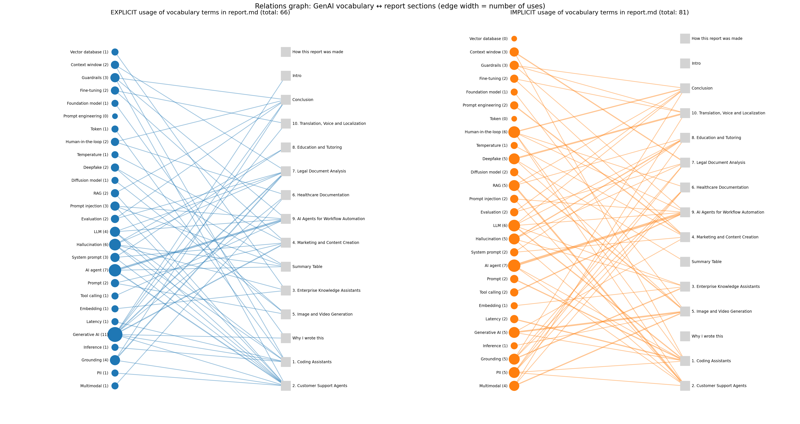
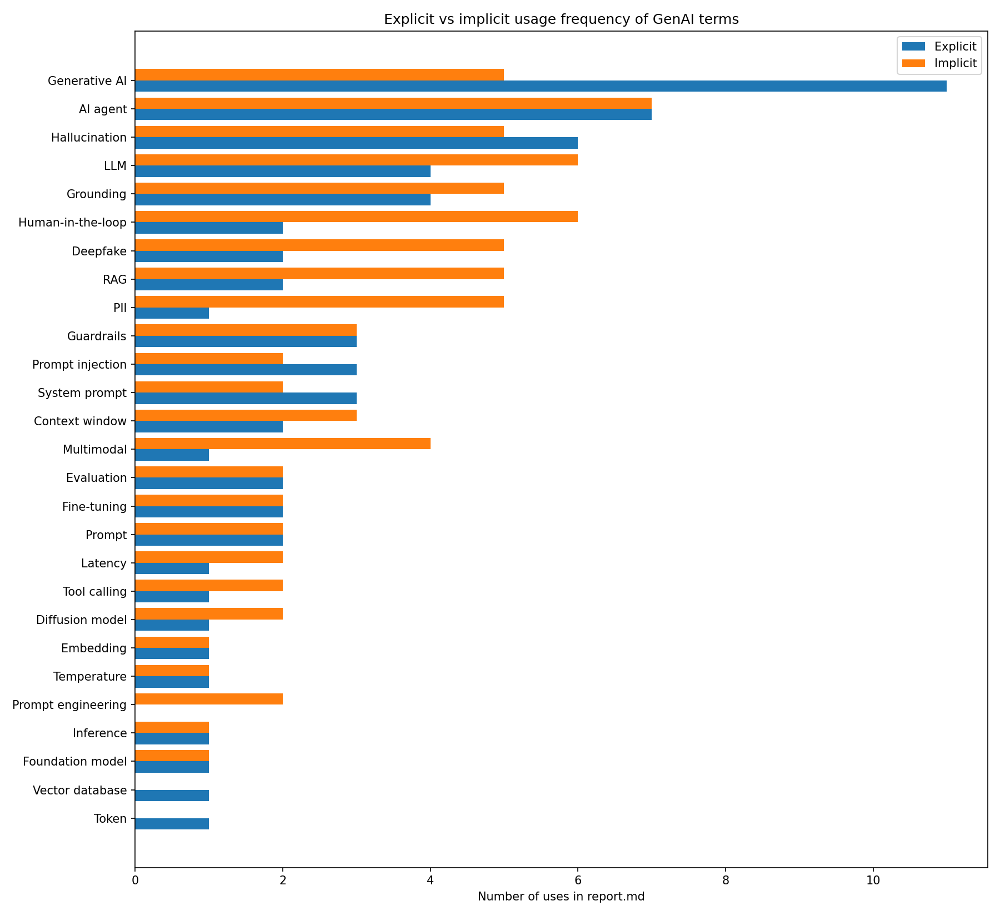

# Research-on-Generative-AI-applications
Research on generative AI applications, implementation challenges, and terminology.

## Contents
-  [Research report](report.md) – 10 GenAI use cases: business value, technical challenges, weak points, real products
-  [Vocabulary](vocabulary.md) – 32 GenAI terms (27 explained manually + 5 added by a CodeMie agent)
-  [Relations graph](graph/) – explicit vs implicit usage of vocabulary terms in the report

## Relations graph (optional subtask)
Explicit usage = the term itself appears in the report. Implicit usage = the idea is expressed
without naming the term (e.g. "never existed" → hallucination). Both are counted separately.

- [terms.json](graph/terms.json) – terms with explicit and implicit forms
- [stats.json](graph/stats.json) – counts per term and per report section
- [build_graph.py](graph/build_graph.py) – Python script (networkx + matplotlib), run in Google Colab

## Automation
A CodeMie assistant ("GenAI Repo Assistant") was integrated with this GitHub repository
through a Git integration and a personal access token. It read vocabulary.md, added the
section "Terms added by CodeMie agent" and committed the change to main using the GitHub
Git Data API (commit a7ea749). This README section was also committed by the agent.
